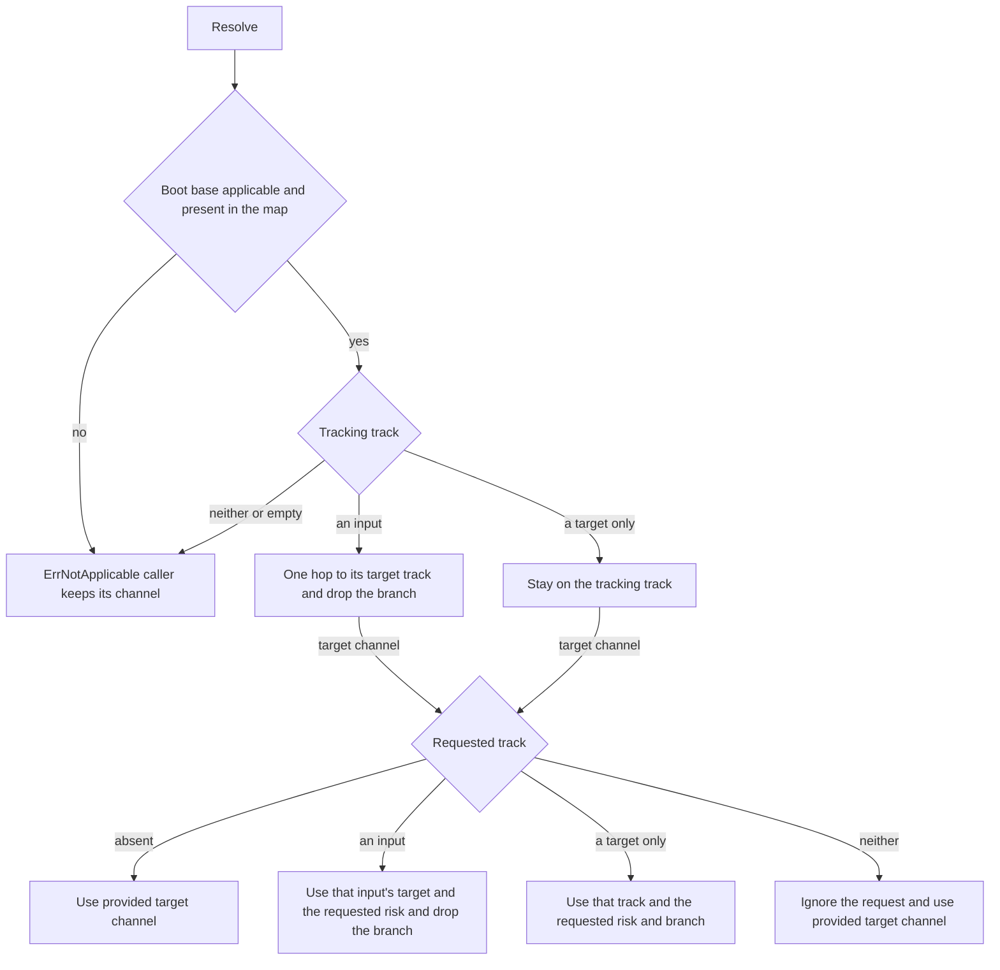

# UC track map policy

Working backup of the refresh channel policy for `snap/uctrack`. Not yet implemented.

This revises the resolution policy in [#17787](https://github.com/canonical/snapd/pull/17787) (`snap/uctrack`). The map type stays as it is. The behavior of a requested channel changes.

## Map shape

Keep [`UbuntuCoreTracks`](../info.go) as `map[bootBase]map[inputTrack]targetTrack`, already described as one or more from-and-to pairs and validated in [`snap/validate.go`](../validate.go) (`checkUbuntuCoreTrackRedirects`).

For the selected boot base, derive two sets from those pairs:

- **Inputs:** the map keys. Each input has exactly one corresponding target.
- **Targets:** the map values. Several inputs may share a target.

A track may appear as both. Publishing `18: "24"` while `latest: "18"` makes `18` a departing track: the next resolution leaves it. A track that must stay put has to be a value only, not a key. No second list is added; a bare target list cannot say which input moves where.

Example for boot base 18:

```yaml
snapd-info:
  ubuntu-core-tracks:
    "18":
      latest: "18"
      fips-updates: "18-fips"
```

Inputs: `latest`, `fips-updates`. Targets: `18`, `18-fips`.

A channel string with no track component is `latest` once it is parsed. `Clean()` still drops a `latest` track on the way out. A risk-only `--channel` is not that string yet: today's refresh resolves it against the tracking track first. See Caller boundary.

A transition follows an input to its target and drops the branch. The risk is kept. `latest/beta/hotfix` becomes `18/beta`. This reverses the #17787 rule that kept the branch on every remap. A stay on the tracking track, and a request that already names a target, keep the branch. A transition onto `latest` therefore renders as `stable`, `edge`, or `beta`.

## When the map does nothing

The caller keeps its channel, and `Resolve` returns `ErrNotApplicable`, when any of these is true:

- The model has no applicable boot base: classic, hybrid classic, a base that is not a core snap, or Ubuntu Core 16. [`SystemBootBaseApplicable`](uctrack.go) already decides this and does not read the map.
- That boot base is absent from the map (missing key, empty map, or nil map). This is the same key lookup as today.
- The tracking channel is empty.
- The tracking track is neither an input nor a target for that boot base.

Other boot bases in the same map are not consulted. A request is not interpreted when the tracking track itself is outside the map: a device tracking `preview` is unchanged, including when `--channel` names `18` or `latest`.

An unparseable channel stays an error. It is not treated as an absent request.

## Decision

**Q1.** The first gate below, boot base applicable and present in the map, is the same as today's `Resolve` on #17787. Applicability is `SystemBootBaseApplicable`. Presence is the boot-base key lookup in `resolveUCTrack`. A miss returns `ErrNotApplicable` and the caller keeps its channel.



Tracking is a path function: the requested-track diamond is reached only after the tracking channel satisfies the map. If the tracking track is empty or neither an input nor a target, the request is not interpreted. Tracking still matters on that path as the gate, even when a later request lookup does not use the provided target channel for the result.

The hop is one hop to its target track, drop branch. The stay keeps the tracking channel, which is already on a target track. Both therefore carry a **target channel** into the requested-track check, not a return. An absent or ignored request uses that channel. Today's `Resolve` already continues this way; only dropping the branch on a hop is new.

Input membership is tested before target membership, for both the tracking track and the requested track. A track that is both follows the hop instead, because input membership is tested first. Put that sentence in a code comment on the algorithm. One hop means that lookup's target is not looked up again: `latest → 18` and `18 → 24` resolves `latest` to `18`.

A requested track that is an input is a second map lookup: that requested input's target, not the tracking hop. `--channel=fips-updates` while tracking `latest` looks up `fips-updates → 18-fips`, not `latest → 18`. The incoming target channel is not used for the result: not its track, risk, or branch. The request supplies the risk; the branch is dropped.

A requested track that is only a target is the same independence: use that track with the requested risk and branch. No map hop, and the provided target channel is unused for the result.

On both of those request paths, tracking is only the gate that the map applies. Comment that too. Today the request is not looked up again.

**Tracking track is an input.** This is the switch onto a UC track, including a later onboard that adds an onward pair. With no effective request, move to that input's corresponding target, keep the tracking risk, and drop the branch. `latest/beta/hotfix` becomes `18/beta`.

**Tracking track is a target and not an input.** Do not leave the target set. With no effective request, stay on the tracking track, risk, and branch. There is no automatic hop.

The request rules are the same in both cases:

- The requested track is an input: look that input up in the map and use its corresponding target, keep the requested risk, and drop the branch. `latest/beta/hotfix` becomes `18/beta`. This is a second lookup, not the tracking hop. The provided target channel is unused for the result. When the tracking track is already a target this can switch targets, and the track name differs from what was asked, so log it.
- The requested track is only a target: use that track, keep the requested risk and branch. This is the allowed switch between targets. The provided target channel is unused for the result, same as an input request. Tracking remains only the gate.
- The requested track is neither: behave as if `--channel` was omitted. Log it. Use the provided target channel. The requested risk and branch are discarded with it.

A result is always a target for this boot base, or the current target when the tracking track is already a target. `ErrRequestedChannelProhibited` goes away. A refresh is not failed because the requested track is outside the map.

Leaving the set is the forbidden move. Moving from `18` to `24` is allowed once `24` is a target, including automatically when `18` is published as an input. A track that is both an input and a target cannot be selected as a destination: `--channel=18` follows `18 → 24`. That stops a repeated channel from refusing an onward onboard.

## Logging

`logger.Noticef` on two successful paths:

- The request matched neither set and was ignored, naming the requested channel and the channel actually used.
- The tracking track is already a target and the requested track is an input. The notice names both channels.

A rewrite while the tracking track is itself an input is the transition the caller asked for and is not logged. No new error type.

## Errors

`ErrRequestedChannelProhibited` is removed. A requested track outside the map is a successful resolution: the request is ignored and the channel taken from the tracking track is used.

`ErrNotApplicable` stays. It still covers a model with no applicable boot base, a boot base absent from the map, an empty tracking channel, and a tracking track that is neither an input nor a target. The caller keeps its channel. It is not returned for a requested track.

An unparseable channel stays `internal error: cannot parse ...`. A nil model stays `internal error: cannot use nil model`. Neither becomes an exported error.

## Permutations

Fixture: boot base 18, `latest → 18`, `fips-updates → 18-fips`. Tracking risk and branch are shown only where they affect the result.

Tracking an input, `latest/stable`:

- No request, or `latest`, `stable`, `latest/stable`: `18/stable`.
- No request, tracking `latest/beta/hotfix`: `18/beta`. The branch is dropped.
- `--channel=latest/edge` or `--channel=edge`: `18/edge`.
- `--channel=fips-updates/beta`: `18-fips/beta`. A different input is its own pair, not the tracking pair.
- `--channel=latest/beta/hotfix` or `--channel=fips-updates/beta/hotfix`: `18/beta` or `18-fips/beta`. A request that names an input is a transition, so its branch is dropped.
- `--channel=18/edge` or `--channel=18/edge/hotfix`: `18/edge` or `18/edge/hotfix`.
- `--channel=18-fips/stable`: `18-fips/stable`.
- `--channel=preview/edge`, and tracking `latest/beta`: ignore, result `18/beta`. The requested risk is not kept.
- `--channel=24/stable` while `24` is not a target: ignore, result `18/stable`.

Tracking an input, `fips-updates/candidate`: no request resolves to `18-fips/candidate`. `--channel=latest/edge` resolves to `18/edge`.

Tracking a target, `18/stable`:

- No request: `18/stable`. Tracking `18/edge/hotfix` stays `18/edge/hotfix`.
- `--channel=18/edge` or `--channel=18/beta/hotfix`: that channel.
- `--channel=18-fips/beta`: `18-fips/beta`.
- `--channel=latest/edge` or `--channel=edge`: `18/edge`, and log the rewrite.
- `--channel=latest/beta/hotfix`: `18/beta`, and log the rewrite. The branch is dropped.
- `--channel=fips-updates/beta`: `18-fips/beta`, and log the rewrite.
- `--channel=preview/edge` or `--channel=24/stable`: ignore, stay `18/stable`, and log.
- No request path and no request can return `latest`, `fips-updates`, or any other non-target.

Not applicable, caller unchanged:

- Classic, hybrid, non-core base, UC16.
- UC22 model while the map only has `"18"`.
- Empty or nil map.
- Empty tracking channel, with or without a request.
- Tracking `preview/stable`, `20/stable`, or `24/edge` on the fixture above, including when the request is `18/edge` or `latest/edge`.

Chain fixture, same boot base, added `18 → 24`. Targets are `18`, `18-fips`, and `24`. Inputs are `latest`, `fips-updates`, and `18`.

- Tracking `latest/stable`: still one hop, to `18/stable`, not `24`.
- Tracking `18/stable`: `18` is an input. No request resolves to `24/stable`. Tracking `18/beta/hotfix` resolves to `24/beta`.
- Tracking `18/stable` with `--channel=18/edge`: input wins, `24/edge`.
- Tracking `18/stable` with `--channel=24/edge`: `24` is only a target, `24/edge`.
- Tracking `24/stable`: `24` is only a target, so the channel stays.
- Tracking `24/stable` with `--channel=18/stable`: `18` is an input, so `24/stable`, logged. The device cannot return to `18`.
- Tracking `24/stable` with `--channel=latest/edge`: `18/edge`, logged. Still inside the target set.

A cycle (`18 → 24` and `24 → 18`) is not walked inside one call, but alternating refreshes would oscillate. Validation does not reject that today; leave it out of `Resolve` unless we want a follow-up check.

## Caller boundary

`Resolve(model, trackingChannel, requestedChannel, tracks)` keeps its signature. [#17610](https://github.com/canonical/snapd/pull/17610) is the caller. It passes the installed snapd tracking channel, which is empty on install, so install stays not applicable and keeps the channel it was given. A revision pin stays outside `Resolve` and is applied to the resolved channel.

Model-based track pinning does not apply to snapd. `snapstate.resolveChannel` only pins the model kernel and gadget (`KernelTrack` / `GadgetTrack`). Snapd takes the unpinned `channel.Resolve` path. Ubuntu Core tracks are snapd-only for now, so that pin and this map do not overlap. A UC20+ `default-channel` on a snapd stanza is an image-time default, not this pin.

A risk-only channel is the store's `latest` track when the snap's `default-track` is unset. A set default track makes the store return `redirect-channel` as `<default-track>/<risk>`, for example `candidate` becomes `2.0/candidate`. An explicit track is not redirected. Snapd adopts `redirect-channel` on install and download. Refresh does not apply it to tracking. It is out of scope for this UC-track refresh channel policy.

On a one-snap refresh, `newChannel` is the raw `--channel` string. The CLI copies it into `RevisionOptions.Channel`, and `resolveChannelForStore` passes that as `newChannel` with the tracking channel as `oldChannel`. `--edge`, `--beta`, `--candidate`, and `--stable` are the same strings (`edge`, `beta`, `candidate`, `stable`). An omitted flag leaves `newChannel` empty, and `resolveChannel` returns the tracking channel. A multi-snap refresh rejects `--channel`. Refresh-all sets `newChannel` to the tracking channel before this call.

## Where `uctrack.Resolve` is called

[#17610](https://github.com/canonical/snapd/pull/17610) calls it while planning a store operation, after the caller's channel is still raw and before the refresh `SnapAction`. For other snaps, `channel.Resolve` still runs first inside `validateAndInitStoreUpdates`. Snapd is skipped there so an empty request is not rewritten into `--channel` set to the tracking track.

Refresh of an installed snapd, in `storeUpdatePlanCore`:

1. A precursor `SnapAction` installs snapd from `latest/stable`, with no installed-snap list, and reads `ubuntu-core-tracks` from that snap.yaml.
2. `uctrack.Resolve(model, installedTrackingChannel, requestedChannel, tracks)`. A named refresh passes `RevisionOptions.Channel` unchanged, so `--channel=edge` arrives as `edge`. Refresh-all forces `requestedChannel` to empty even though the tracking channel was copied into `RevOpts.Channel`. `ErrNotApplicable` leaves the caller's channel alone.
3. A non-empty result replaces `RevOpts.Channel`.
4. A named refresh then calls `resolveChannelForStore`, which is `channel.Resolve(tracking, resolvedChannel)`. A channel that already names a track is unchanged. A flag that policy did not rewrite still gets today's relative resolution here.
5. The refresh `SnapAction` uses that channel. A validation-set pin can clear it; `restoreSnapdUCTrackChannel` puts it back and the pinned revision is queried on that track. `requireSnapdEffectiveChannel` clears a store `redirect-channel` and requires the reported effective channel to name the requested one.

Install calls the same helper from `storeInstallGoal.toInstall`, before its `SnapAction`. Tracking is empty, so `Resolve` returns `ErrNotApplicable` and the install channel is kept. One action is sent. Download and path install do not call it. `snap switch` does not call it.

`channel.Resolve` prefixes the tracking track only when that channel's track component is non-empty. Tracking `18/stable` and `--edge` becomes `18/edge`. Tracking `stable` or an empty channel leaves the flag as `edge`, and that string is what the store action sends. Snapd does not rewrite it to `latest/edge`. A model-pinned kernel or gadget uses the pinned track. That run is step 4, after `Resolve`. Inside `Resolve`, `normalizeChannel` sees the raw flag and treats a missing track as `latest`. Tracking `18/stable` and `--channel=edge` is therefore an input request for `latest`, not a request for `18/edge`. Rows S3, S7, and S29 match that input. On the chain map the same flag follows `latest`, so it does not first become `18/edge` and then hop with `18`.

[#17610](https://github.com/canonical/snapd/pull/17610) still describes the old errors, including `ErrRequestedChannelProhibited`. This policy replaces that result. The call site stays.

## Test reference

Later tests of `Resolve` assert these rows. Tests name a track as an input, a target, or neither. They do not name case A or case B. `--channel` is the raw flag `Resolve` receives, so a missing track is `latest` inside `Resolve`. Result is the cleaned channel: a `latest` track is omitted, so `latest/edge` is `edge`. `(none)` means refresh without `--channel`. Log is `—`, `ignored` (the requested track is neither an input nor a target), or `rewritten` (the tracking track is already a target and the requested track is an input).

An omitted track is `latest`. An omitted risk is `stable`. A transition drops the branch. A request that names only a target keeps the requested branch. An absent or ignored request uses the channel taken from the tracking track: the input's target when tracking an input, the tracking channel when tracking a target.

Rows G14–G17 follow the diagram's shared keep node. `Resolve` returns `ErrNotApplicable` and the refresh uses the channel the caller already chose, which is the requested channel when `--channel` is set. The prose above also says a device tracking `preview` stays there when `--channel` names `18` or `latest`. Those four rows are the ones to confirm.

### Simple map

Boot base 18. `latest → 18`, `fips-updates → 18-fips`. Inputs: `latest`, `fips-updates`. Targets: `18`, `18-fips`.

| # | Tracking | --channel | Situation | Result | Log | Note |
| --- | --- | --- | --- | --- | --- | --- |
| S1 | latest/stable | (none) | tracking input, no request | 18/stable | — | |
| S2 | latest/stable | latest | tracking input, requested input | 18/stable | — | Same result as S1, by a second lookup |
| S3 | latest/stable | stable | tracking input, requested input | 18/stable | — | Omitted track is latest |
| S4 | latest/stable | latest/stable | tracking input, requested input | 18/stable | — | |
| S5 | latest/beta/hotfix | (none) | tracking input, no request | 18/beta | — | Branch dropped |
| S6 | latest/stable | latest/edge | tracking input, requested input | 18/edge | — | |
| S7 | latest/stable | edge | tracking input, requested input | 18/edge | — | Omitted track is latest |
| S8 | latest/stable | fips-updates/beta | tracking input, requested input | 18-fips/beta | — | Other pair, not the tracking pair |
| S9 | latest/beta | fips-updates/stable | tracking input, requested input | 18-fips/stable | — | Requested risk, not the tracking risk |
| S10 | latest/stable | latest/beta/hotfix | tracking input, requested input | 18/beta | — | Branch dropped |
| S11 | latest/stable | fips-updates/beta/hotfix | tracking input, requested input | 18-fips/beta | — | Branch dropped |
| S12 | latest/stable | 18/edge | tracking input, requested target | 18/edge | — | |
| S13 | latest/stable | 18/edge/hotfix | tracking input, requested target | 18/edge/hotfix | — | Branch kept |
| S14 | latest/beta | 18/stable | tracking input, requested target | 18/stable | — | Tracking risk is not kept |
| S15 | latest/stable | 18 | tracking input, requested target | 18/stable | — | Omitted risk is stable |
| S16 | latest/stable | 18-fips/stable | tracking input, requested target | 18-fips/stable | — | |
| S17 | latest/beta | preview/edge | tracking input, outside the map | 18/beta | ignored | Requested risk is discarded |
| S18 | latest/beta/hotfix | preview/edge | tracking input, outside the map | 18/beta | ignored | Hop already dropped the branch |
| S19 | latest/stable | 24/stable | tracking input, outside the map | 18/stable | ignored | 24 is not a target |
| S20 | fips-updates/candidate | (none) | tracking input, no request | 18-fips/candidate | — | |
| S21 | fips-updates/candidate | latest/edge | tracking input, requested input | 18/edge | — | |
| S22 | 18/stable | (none) | tracking target, no request | 18/stable | — | |
| S23 | 18/edge/hotfix | (none) | tracking target, no request | 18/edge/hotfix | — | Branch kept |
| S24 | 18/stable | 18/edge | tracking target, requested target | 18/edge | — | |
| S25 | 18/stable | 18/beta/hotfix | tracking target, requested target | 18/beta/hotfix | — | Branch kept |
| S26 | 18/edge/hotfix | 18/stable | tracking target, requested target | 18/stable | — | Request replaces the branch |
| S27 | 18/stable | 18-fips/beta | tracking target, requested target | 18-fips/beta | — | Switch between targets |
| S28 | 18/stable | latest/edge | tracking target, requested input | 18/edge | rewritten | |
| S29 | 18/stable | edge | tracking target, requested input | 18/edge | rewritten | Omitted track is latest |
| S30 | 18/stable | latest/beta/hotfix | tracking target, requested input | 18/beta | rewritten | Branch dropped |
| S31 | 18/edge/hotfix | latest/stable | tracking target, requested input | 18/stable | rewritten | Tracking branch is not kept |
| S32 | 18/stable | fips-updates/beta | tracking target, requested input | 18-fips/beta | rewritten | |
| S33 | 18/stable | preview/edge | tracking target, outside the map | 18/stable | ignored | |
| S34 | 18/edge/hotfix | preview/stable | tracking target, outside the map | 18/edge/hotfix | ignored | Stay keeps risk and branch |
| S35 | 18/stable | 24/stable | tracking target, outside the map | 18/stable | ignored | |
| S36 | 18-fips/stable | (none) | tracking target, no request | 18-fips/stable | — | |
| S37 | 18-fips/beta | 18/edge | tracking target, requested target | 18/edge | — | Switch between targets |

### Chain map

Same boot base, with `18 → 24` added. Inputs: `latest`, `fips-updates`, `18`. Targets: `18`, `18-fips`, `24`. Input membership is tested first, so `18` hops.

| # | Tracking | --channel | Situation | Result | Log | Note |
| --- | --- | --- | --- | --- | --- | --- |
| C1 | latest/stable | (none) | tracking input, no request | 18/stable | — | One hop, not 24 |
| C2 | latest/beta/hotfix | (none) | tracking input, no request | 18/beta | — | Branch dropped |
| C3 | latest/stable | 18/edge | tracking input, requested input | 24/edge | — | 18 is an input, so this is not a stay on 18 |
| C4 | latest/stable | 18/edge/hotfix | tracking input, requested input | 24/edge | — | Branch dropped |
| C5 | latest/stable | 24/edge | tracking input, requested target | 24/edge | — | |
| C6 | latest/stable | 24/edge/hotfix | tracking input, requested target | 24/edge/hotfix | — | Branch kept |
| C7 | latest/stable | latest/edge | tracking input, requested input | 18/edge | — | Lookup of latest, not of 18 |
| C8 | 18/stable | (none) | tracking input, no request | 24/stable | — | 18 is an input |
| C9 | 18/beta/hotfix | (none) | tracking input, no request | 24/beta | — | Branch dropped |
| C10 | 18/stable | 18/edge | tracking input, requested input | 24/edge | — | Input wins over target |
| C11 | 18/stable | 24/edge | tracking input, requested target | 24/edge | — | |
| C12 | 18/stable | latest/edge | tracking input, requested input | 18/edge | — | Second lookup; the tracking hop to 24 is not used |
| C13 | 18/beta | fips-updates/beta | tracking input, requested input | 18-fips/beta | — | |
| C14 | 18/stable | preview/edge | tracking input, outside the map | 24/stable | ignored | Ignored request uses the hop |
| C15 | 24/stable | (none) | tracking target, no request | 24/stable | — | |
| C16 | 24/edge/hotfix | (none) | tracking target, no request | 24/edge/hotfix | — | |
| C17 | 24/stable | 18/stable | tracking target, requested input | 24/stable | rewritten | Cannot return to 18 |
| C18 | 24/stable | 18/beta/hotfix | tracking target, requested input | 24/beta | rewritten | Branch dropped |
| C19 | 24/stable | latest/edge | tracking target, requested input | 18/edge | rewritten | 18 is still a target |
| C20 | 24/stable | fips-updates/beta | tracking target, requested input | 18-fips/beta | rewritten | |
| C21 | 24/stable | 24/edge | tracking target, requested target | 24/edge | — | |
| C22 | 24/stable | 18-fips/stable | tracking target, requested target | 18-fips/stable | — | |
| C23 | 24/stable | preview/edge | tracking target, outside the map | 24/stable | ignored | |
| C24 | 24/beta/hotfix | latest/stable | tracking target, requested input | 18/stable | rewritten | Tracking branch is not kept |

### Map does not apply

`Resolve` returns no channel. The refresh channel is the one the caller already chose.

| # | Situation | Tracking | --channel | Result | Note |
| --- | --- | --- | --- | --- | --- |
| G1 | Classic | latest/stable | (none) | stable | |
| G2 | Classic | latest/stable | 18/edge | 18/edge | |
| G3 | Hybrid classic | latest/stable | (none) | stable | |
| G4 | Base is not a core snap | latest/stable | (none) | stable | |
| G5 | Ubuntu Core 16 | latest/stable | (none) | stable | |
| G6 | UC22, map only has 18 | latest/stable | (none) | stable | |
| G7 | UC22, map only has 18 | latest/stable | 18/edge | 18/edge | |
| G8 | Empty map | latest/stable | (none) | stable | |
| G9 | Nil map | latest/stable | 18/stable | 18/stable | |
| G10 | Boot-base key present, no pairs | latest/stable | (none) | stable | Both sets are empty |
| G11 | Empty tracking | (empty) | (none) | no channel | |
| G12 | Empty tracking | (empty) | 18/edge | 18/edge | |
| G13 | Tracking outside the map | preview/stable | (none) | preview/stable | |
| G14 | Tracking outside the map | preview/stable | 18/edge | 18/edge | Prose says stay on preview/stable |
| G15 | Tracking outside the map | preview/stable | latest/edge | edge | Prose says stay on preview/stable |
| G16 | Tracking outside the map | 20/stable | 18/edge | 18/edge | Prose says stay on 20/stable |
| G17 | 24 is not a target on the simple map | 24/edge | latest/edge | edge | Prose says stay on 24/edge |
| G18 | Unparseable tracking | not-a-channel | (none) | error | Not an absent request |
| G19 | Unparseable request | latest/stable | not-a-channel | error | Not treated as no --channel |
| G20 | Nil model | latest/stable | (none) | internal error | Not ErrNotApplicable |

## Code once this policy is accepted

Work on this branch, `ernest/SNAPD-37381/evolve-uc-track-resolution`. Current `Resolve` still returns `ErrRequestedChannelProhibited` for a requested track outside the resolved track.

- Rewrite the decision in [`uctrack.go`](uctrack.go), drop `ErrRequestedChannelProhibited`, and comment the algorithm with: tracking is a path function, the request is considered only after the tracking channel satisfies the map; a track that is both follows the hop instead, because input membership is tested first; a requested input is a second map lookup of that input's target, not the tracking hop, and does not use the provided target channel for the result.
- Replace the fail-closed request tests in [`uctrack_test.go`](uctrack_test.go) with the permutations above, including the chain fixture and the log lines.
- Leave the snap.yaml type and [`validateUbuntuCoreTracks`](../validate.go) as they are.
